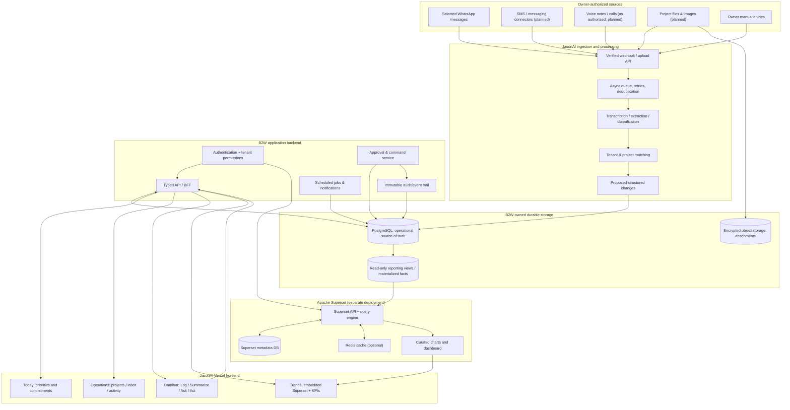

# JasonAI — Information Architecture and Apache Superset Integration

**Status:** Proposed production architecture; **not an implemented backend**  
**Design reference:** `dashboard/index.html` on `preview/operations-dashboard-v1`  
**Frontend:** Today / Operations / Trends; bottom omnibar: Log / Summarize / Ask / Act  
**Last reviewed:** 2026-10-12

> **Architectural decision:** B2W/JasonAI owns operational records, permissions, AI behavior, and transactional changes. Apache Superset is the *read-only analytics and charting layer*, embedded mainly into Trends. The current Vercel preview is a static HTML/CSS/JS mock that holds illustrative arrays in the browser; **it is not currently connected to Superset, a persistent database, or live messaging**.

## 1. System map: source → normalization → storage → API → interface



**Important corrections to a "Superset-built app" assumption:**

1. Superset does not ingest owner messages, maintain job records as the transactional source of truth, execute payroll, or enforce owner approvals. These belong to B2W services.
2. Superset queries SQL datasets that B2W publishes to it, and builds metrics, charts, filters, and dashboards. It can be embedded without exposing the full Superset UI.
3. The Superset **metadata DB** holds Superset definitions/users/charts; B2W's **application DB** holds contractor projects and payments. Never treat these as one database merely because they can both use PostgreSQL.
4. The Vercel dashboard site is a **client** of B2W APIs and an **embedding host** for Superset; Vercel is not where the Apache Superset server, Redis, and workers are presumed to run.

## 2. Ownership of every subsystem

| Responsibility | Owner | Interface / output |
|---|---|---|
| Authorized source connectors | B2W ingestion service | Verified events, attachments |
| Message capture & dedupe | B2W ingestion service | `source_message`, `source_event` |
| Extraction, memory, suggested edits | JasonAI worker + AI providers | Proposals with citations and confidence |
| Account identity, workspace roles | B2W auth service | Tenant-scoped session |
| Projects, crew, rates, jobs | B2W operations API | Validated database entities |
| Labor approvals / marking paid | B2W command + audit service | Immutable transitions and audit entries |
| Activity feed / owner brief | B2W read-model API | Prioritized, tenant-filtered lists |
| Historical charts and BI metrics | Superset + SQL reporting views | Embeddable dashboard |
| Embedded Superset guest tokens | **Trusted B2W backend only** | Short-lived, scoped token |
| B2W UI, navigation, dark/light, omnibar | B2W frontend | Screens and interactions |

Use one stable **`tenant_id`** on all business records and filters. An authenticated user's current workspace resolves to exactly one authorized tenant; the client must not be allowed to choose arbitrary tenant IDs.

## 3. Durable data model (suggested PostgreSQL schema)

| Table / read model | Key fields | Why |
|---|---|---|
| `tenants` | `id, display_name, timezone` | Contractor accounts |
| `users` / `memberships` | `user_id, tenant_id, role` | Workspace access and roles |
| `projects` | `id, tenant_id, name, status, client_id, estimated_total, updated_at` | Jobs & progress |
| `workers` | `id, tenant_id, name, trade, current_rate, rate_type` | Labor directory |
| `labor_entries` | `id, tenant_id, project_id, worker_id, work_date, hours_or_days, applied_rate, amount, source_id, state` | Verified labor facts |
| `payment_obligations` | `id, tenant_id, worker_id, project_id, amount, due_date, state` | Amounts owed |
| `payments` | `id, tenant_id, obligation_id, amount, paid_at, reference, approved_by` | Recorded disbursements |
| `source_messages` | `id, tenant_id, source_type, source_external_id, project_id, content_ref, received_at` | Message provenance / dedupe |
| `source_attachments` | `id, tenant_id, source_message_id, object_key, media_type` | Document / voice references |
| `proposed_actions` | `id, tenant_id, type, structured_payload, source_message_ids, state, reviewer_id` | AI suggestions requiring review |
| `activity_events` | `id, tenant_id, actor_id, entity_type, entity_id, kind, occurred_at` | Timeline + audits |
| `reporting.daily_project_facts` | `tenant_id, project_id, business_date, labor_due, labor_paid, customer_balance, changes_count` | Curated Superset dataset |

Implementation constraints: foreign keys within tenant boundaries, server-side role checks, numeric money values with explicit currency, `created_at/updated_at` timestamps, immutable accepted labor rates on historical entries, unique `(source_type, tenant_id, source_external_id)` for idempotency, and append-only audit records for approvals.

**Avoid unverified assumptions:** worker "daily rate" is not the same thing as hourly labor; the UI's existing illustrative day rates cannot be treated as an accounting ledger. `payment_obligations` must distinguish *due*, *approved*, *paid*, and *void*.

## 4. End-to-end data journeys

### A. Incoming message → proposed project action

1. An account owner grants the minimum authorized connector scope.
2. B2W receives and authenticates the source event (webhook signature, user authorization, scope).
3. Store an idempotency key and any permitted encrypted source content.
4. Worker classifies project, people, amount, and dates; links the **specific source text/voice transcript**.
5. Proposed change is saved as `proposed_actions.state = pending`; **not automatically applied**.
6. Today and Operations get an activity item via a tenant-scoped read API.
7. Owner reviews the source and approves/rejects; backend validates permissions and state transition, writes the change transactionally, and appends an audit event.
8. Reporting views refresh; trends reflect the approved change.

### B. Labor → Friday payroll

1. Crew hours/days enter `labor_entries` as proposed or verified values.
2. Owner inspects worker, project, date, applied rate, source, and duplicate warnings.
3. Approval generates or updates an obligation; a separate authorized workflow records payment.
4. The **Today** total derives from open obligations due by the relevant cutoff; **Operations** provides row-level corrections.
5. Superset receives **read-only** aggregates, not approval commands or the ability to mark paid.

### C. Omnibar

| Mode | Backend contract | Safety boundary |
|---|---|---|
| **Log** | `POST /api/v1/notes` → ingestion pipeline | Create draft/source note, not final payroll entry |
| **Summarize** | `POST /api/v1/assistant/summarize` | Cite source events and indicate data freshness |
| **Ask** | `POST /api/v1/assistant/query` | Tenant-scoped retrieval; never fetch across customers |
| **Act** | `POST /api/v1/actions/propose` | Return proposed action ID; confirm through separate owner approval endpoint |

Do not let a model directly execute arbitrary SQL or issue privileged write queries through Superset. Enforce an allowlist of permitted tools, server-side input validation, source attribution, approval thresholds, and an explicit audit record.

## 5. Frontend → API / Superset mapping

| Visible surface | Primary query / operation | Rendered UI | Superset? |
|---|---|---|---|
| Today: payroll due | `GET /api/v1/today` | Total & due items | No: time-sensitive operational state |
| Today: pending approvals | `GET /api/v1/actions?state=pending` | Review buttons | No |
| Operations: projects | `GET /api/v1/projects` | Expandable cards / details | No |
| Operations: labor | `GET /api/v1/labor?range=week` | Editable/expandable rows | No |
| Operations: activity | `GET /api/v1/activity` | Source-linked activity | No |
| Operations: approve/reject | `POST /api/v1/actions/:id/approve` or `/reject` | Mutation confirmation | No |
| Operations: payment recording | `POST /api/v1/payment-obligations/:id/record-payment` | Payment status | No |
| Trends: overview KPIs | `GET /api/v1/trends/summary` | KPI cards | Optional |
| Trends: payroll, margin, trends | Embedded Superset dashboard reading reporting views | Filterable charts | **Yes** |
| Trends: Superset guest token | `POST /api/v1/analytics/guest-token` | Host SDK only | **Yes, trusted backend** |
| Account menu & theme | Session API + browser preference | Workspace selector; light/dark | No |

**Backend return-shape principle:** Frontend receives normalized amounts, status enums, timestamps, source references, and server-generated `next_actions`; do not rely on hard-coded project names or compute authoritative payroll totals in browser JS.

## 6. Building the Trends page with Apache Superset

### 6.1 Deploy components separately

Superset's documented architecture consists of the web application/API, a **separate metadata DB**, optional Redis caching, and optional Celery worker/beat required for some capabilities (reports, async queries, thumbnails). The Superset server executes SQL against a connected analytical source to serve chart data.

**Recommended placement:** Vercel for B2W frontend + API gateway/BFF where suitable; managed PostgreSQL for operational records; an independent container/managed service for Apache Superset; standalone backed-up Superset metadata database; Redis and Celery when required. For a first proof of concept, Docker Compose is convenient; for scaled production, follow the current Kubernetes guidance and operational security requirements.

Official: https://superset.apache.org/admin-docs/installation/architecture/ and https://superset.apache.org/docs/installation/installation-methods/

### 6.2 Expose SQL views to Superset (never production write credentials)

Read-only examples, names illustrative:

```sql
CREATE VIEW reporting.v_project_payroll_daily AS
SELECT tenant_id, project_id, due_date::date AS day,
       SUM(CASE WHEN state IN ('due','approved') THEN amount ELSE 0 END) AS outstanding_amount,
       SUM(CASE WHEN state = 'paid' THEN amount ELSE 0 END) AS paid_amount
FROM payment_obligations
GROUP BY tenant_id, project_id, due_date::date;
```

In a real schema, prefer a reconciled read model that sums completed payment transactions and handles partial payments and voids; the above is schematic and only valid if the obligation state model is mutually exclusive and payment reporting semantics are agreed.

Connect Superset to PostgreSQL using a **read-only DB role** allowed to select `reporting.*` and not `public.*` business tables. Superset requires appropriate SQLAlchemy / Python DB drivers installed for the database.

Official: https://superset.apache.org/docs/databases/

### 6.3 Register datasets and dashboards

Create Superset datasets over reporting views and explicitly define metrics:
- `labor_due`, `labor_paid`, `labor_approved`, `customer_balance`
- counts of projects by status and pending approvals over time
- daily/weekly labor cost by project, worker trade, date
- lead/lag analysis (time from field update → review → approval)

Build the **JasonAI Trends** Superset dashboard with tenant-safe datasets, date filters, project filters, and cross-filtering as appropriate; hide redundant embedded title/navigation when presented inside the B2W frame. Superset's API allows managing datasets, charts, dashboards, and embedded configurations.

Official: https://superset.apache.org/docs/rest-api/

### 6.4 Embed securely

Superset documents `@superset-ui/embedded-sdk`, `EMBEDDED_SUPERSET` and an app-issued guest token. Use a trusted backend for the token; **never mint the token from browser code and never expose a Superset service account credential to the client**.

**Host code, illustrative React/JS:**

```js
import { embedDashboard } from '@superset-ui/embedded-sdk';

await embedDashboard({
  id: SUPSERSET_EMBEDDED_DASHBOARD_UUID,
  supersetDomain: SUPSERSET_ORIGIN,
  mountPoint: document.getElementById('trends-superset'),
  fetchGuestToken: async () => {
    const response = await fetch('/api/v1/analytics/guest-token', {
      method: 'POST',
      credentials: 'include'
    });
    if (!response.ok) throw new Error('Unable to authorize analytics');
    return (await response.json()).token;
  },
  dashboardUiConfig: {
    hideTitle: true,
    filters: { expanded: false }
  }
});
```

Replace placeholders (including the `SUPSERSET_*` pseudonames) with validated, environment-specific values. Current `dashboard/index.html` is standalone vanilla JavaScript, so production would either bundle the embedded SDK or load an officially supported distribution rather than assuming ESM imports work in the existing file.

**Guest-token issuer contract** (server-side):
1. Authenticate B2W session; resolve tenant and Superset dashboard entitlement from server-owned records.
2. Call Superset's `POST /api/v1/security/guest_token/` with a privileged **server-only service account**, scoped resource `{ type: "dashboard", id: <approved dashboard UUID> }`.
3. Add necessary `rls` clauses for `tenant_id`, derived server-side, not from the browser. Prefer fixed dataset allowlists and server-issued entitlements.
4. Return short-lived token to SDK; permit token refresh and handle unauthorized/expired state.
5. Configure allowed embed origins, HTTPS, iframe policy, Superset guest role permissions, query limits, and least-privilege database access.

Superset's embedding docs mention guest-token expiry (default 5 minutes), permitted embedding origins, and row-level security behavior; validate the exact version deployed and the iframe and token behavior before production.

Official: https://superset.apache.org/user-docs/using-superset/embedding/  
SDK source: https://github.com/apache/superset/tree/master/superset-embedded-sdk

### 6.5 Tenant isolation — critical

Defense in depth:
- **B2W API:** filter every request by authenticated tenant, enforce membership and permission, protect mutations with transaction + idempotency + audit.
- **Data layer:** restrict Superset DB user to curated views; consider PostgreSQL RLS or tenant-specific views with vetted authorization semantics.
- **Superset:** guest token `rls`, explicit allowed dashboard resources, role limitations, and test queries for tenant leaks including filters, drilldowns, exports, cache interactions.
- **Caching:** inspect cache keys/security in the actual Superset version; never assume cached results are safe across tenants without tests.
- **Source privacy:** limit content retention, sanitize sensitive fields before analytical publication, use signed URLs for source attachments, and do not expose raw chat content in Superset.

An empty allowed-domains list can permit embeds from any origin; configure a production allowlist explicitly. Semantic dataset/view security capabilities differ from SQL datasets; confirm with your chosen Superset version before mixing them.

Official: https://superset.apache.org/user-docs/using-superset/embedding/ and https://superset.apache.org/docs/6.0.0/security/

## 7. Screen-level UI data contract and refresh strategy

### Today
Server builds a priority read model, sorting: blocked commitments → overdue / due soon → actions needing approval → informational events. Each item includes `source_ids`, `as_of` timestamp and `actionability`. Use optimistic transitions *only after validated mutation response*.

### Operations
Three sections in one view: Projects, Labor, Activity. Each reuses tenant-scoped IDs; expand rows to retrieve detail rather than loading every message upfront. Make edit actions explicit and versioned to prevent concurrent overwrites.

### Trends
Use read-only Superset charts embedded inside the same design shell. Keep the B2W navigation and omnibar outside the Superset iframe. KPI tiles can be B2W APIs for consistency; Superset dashboard supplies long-range analytics. Apply time-zone normalization and a visible `last_updated` marker.

### Omnibar
Independent of screen state; pressing enter submits a request with `workspace_id` resolved by the server session and `mode` from a validated enum. Summarize and Ask must return grounding/evidence; Act returns a preview object, not an external side effect.

### Navigation and motion
For Today → Operations → Trends: **wipe outgoing content completely**, then mount the next view and reveal it. Keep the header/omnibar stable. Reduced-motion users get an immediate swap. Animation must not alter business data.

## 8. Dev and production environment split

| Component | Demo preview now | Target MVP |
|---|---|---|
| UI | Static `dashboard/index.html` | Typed frontend components + tests |
| Data | JS arrays with illustrative jobs/workers | Tenant-scoped PostgreSQL |
| Auth | Demo name/account menu | User accounts + memberships |
| AI omnibar | Static canned responses | Authenticated JasonAI APIs |
| Approvals | Local `Set` state | Transactional command/audit service |
| Superset | Placeholder text + CSS bars | Deployed Superset + embedded dashboard |
| Theme | Browser local storage | Browser storage + account preference optional |
| Deployment | GitHub branch → Vercel preview | CI, preview/staging/prod, secret management |

## 9. Build sequence and acceptance criteria

1. **Contracts & schema:** confirm tenant model, payroll rate units, dates, approval states, client balance semantics. Create migrations + seed data matching mock.
2. **Read APIs:** implement Today, Projects, Labor, Activity APIs; check tenant isolation and source links.
3. **Mutation APIs:** approvals, rejected proposals, edits, payment recording with audit + rollback behavior.
4. **AI ingestion:** authorized webhook/connector, dedupe, per-message provenance, extraction, safe proposal queue.
5. **Superset stack:** deploy standalone instance, managed metadata DB, read-only reporting connection; publish curated datasets and Trends dashboard.
6. **Embedding:** guest-token BFF, exact domain allowlist, RLS, test two isolated tenants, token refresh, CSP/iframe acceptance and mobile layouts.
7. **Harden:** source privacy, auditability, load tests, accessibility, data latency, disaster recovery, alerts, instrumentation.

**Definition of done for Superset:** real metrics from authorized tenant reporting data; no write path from Superset to payroll; successful interactive embed under B2W login; cross-tenant tests negative; dark/light presentation addressed; backups and query budgets; no credentials shipped to browser.

**Definition of done for dashboard transition:** old screen wipes first, is no longer interactive while exiting, next screen is rendered only afterward, then content appears (with line stagger), no flashing two screens and reduced-motion support.

## 10. Documentation and references

Apache Superset official documentation (the deployed Superset version must be pinned and rechecked):
- [Superset Architecture](https://superset.apache.org/admin-docs/installation/architecture/)
- [Installation Methods](https://superset.apache.org/docs/installation/installation-methods/)
- [Connecting to Databases](https://superset.apache.org/docs/databases/)
- [Embedding Superset](https://superset.apache.org/user-docs/using-superset/embedding/)
- [REST API](https://superset.apache.org/docs/rest-api/)
- [Security and RLS](https://superset.apache.org/docs/6.0.0/security/)
- [Caching](https://superset.apache.org/docs/configuration/cache/)
- [Open-source Embedded SDK](https://github.com/apache/superset/tree/master/superset-embedded-sdk)
- [Apache Superset source](https://github.com/apache/superset)

---
**Decision summary:** Build a narrow, auditable operational backend and re-use Apache Superset for read-only analytical visualizations. Do **not** claim the existing static dashboard already runs on Superset.
